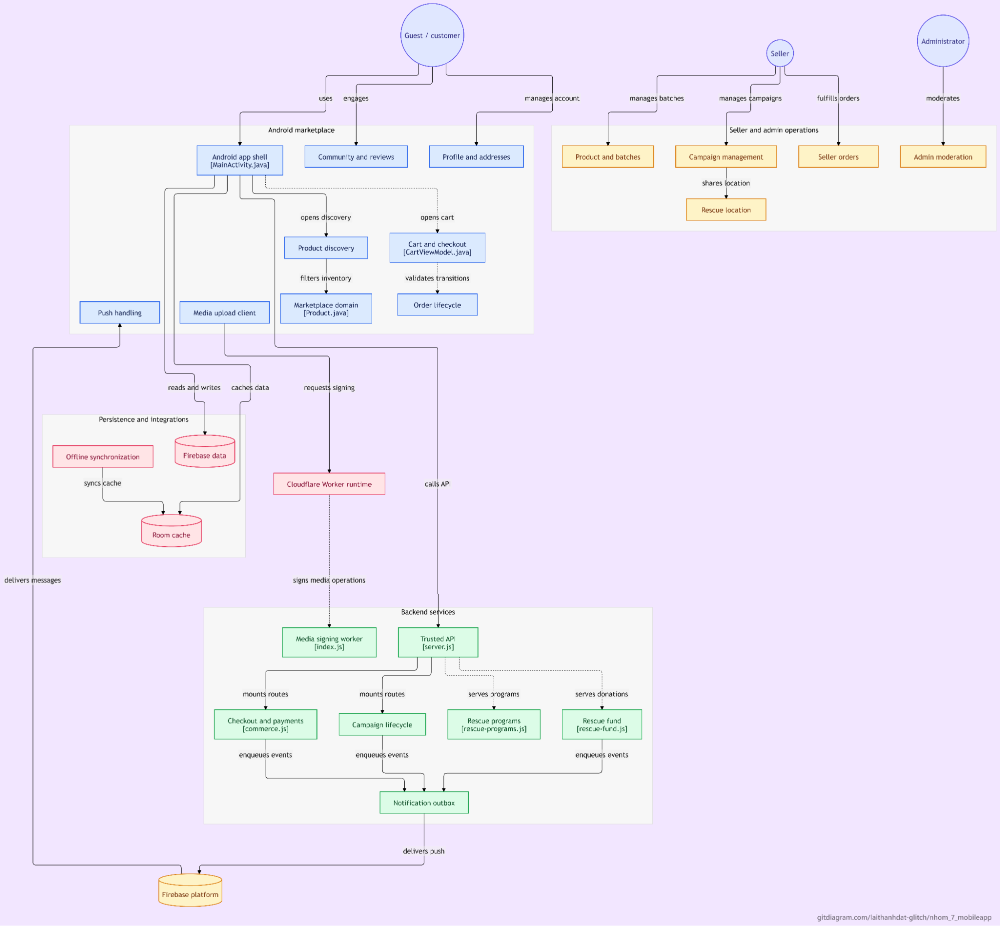
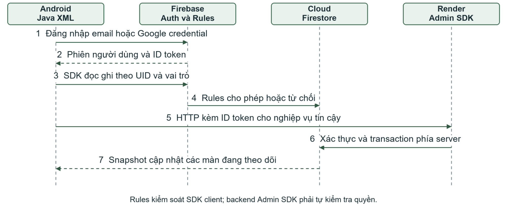
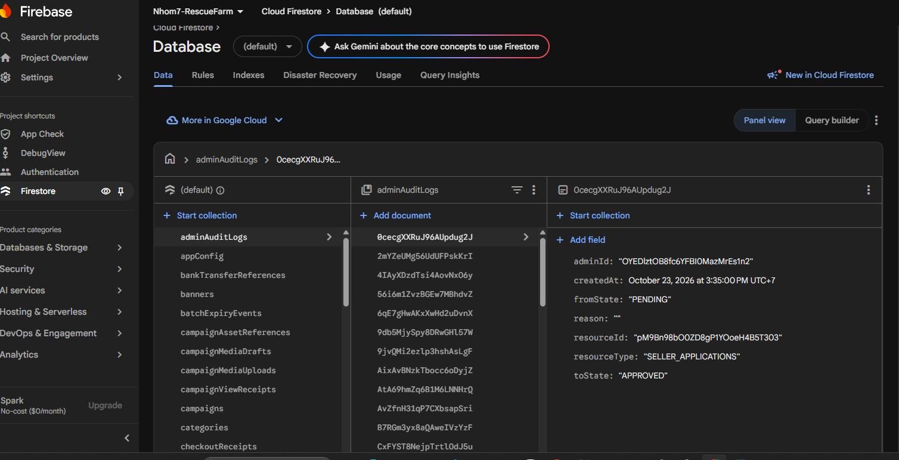
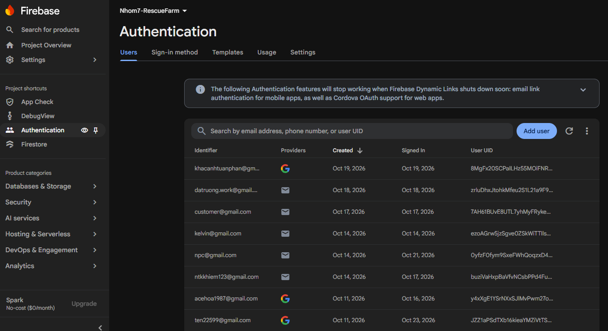
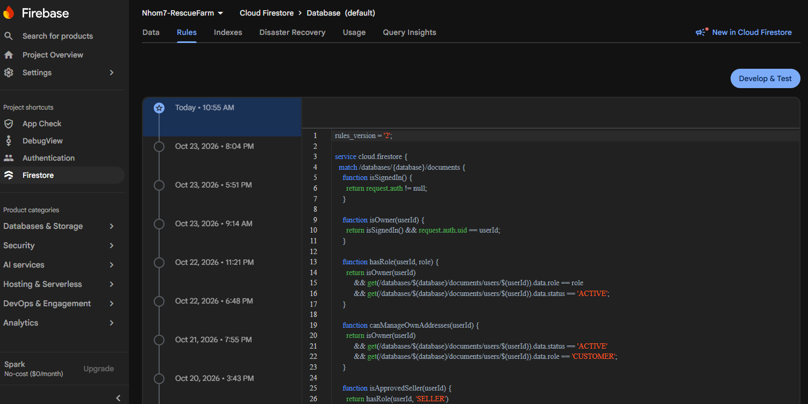

# CHƯƠNG 5. XÂY DỰNG ỨNG DỤNG

## 5.1. Cấu Trúc của Ứng dụng

RescueFarm được xây dựng bằng Java và XML Views trên Android, phục vụ Guest, Customer, Seller và Admin. Chương này trình bày cách tổ chức mã nguồn, kết nối Firebase và phối hợp dữ liệu giữa các trang.



Hình 5.1 Tổng quan các thành phần RescueFarm

Hình trên là cách tổ chức của hệ thống trong ứng dụng Android, tầng truy cập dữ liệu và backend. Ở Android, Fragment hiển thị nội dung, ViewModel giữ trạng thái màn hình và Repository phối hợp Firebase với bộ nhớ cục bộ. Các tác vụ như checkout, kiểm tra tồn kho và xác minh thanh toán được xử lý tập trung tại server nhằm tránh rủi ro từ dữ liệu phía người dùng.

Bảng 5.1 Ánh xạ cấu trúc mã nguồn và vai trò

| Thành phần | Vai trò | Ví dụ trong mã nguồn |
| --- | --- | --- |
| ui/ | Fragment, ViewModel, adapter và trạng thái theo màn hình | HomeViewModel, CampaignDetailFragment, CartViewModel |
| domain/ | Model, enum và logic nghiệp vụ được tách biệt ra khỏi UI | Product, ProductBatch, RescueCampaign, Comment |
| data/repository/ | Quản lý đọc/ghi dữ liệu, tự động chọn nguồn theo session | ProductRepository, CartRepositoryFactory |
| data/remote/firebase/ | Query, listener, ánh xạ document và xử lý quyền truy cập | FirebaseProductRepository, SnapshotLiveData |
| data/local/ | Quản lý Room database (entity, DAO, mapper) và lưu trữ cài đặt cục bộ | RescueFarmDatabase, HomeLocationStore |
| service/ | HTTP backend, GPS, media, giá/kho và đồng bộ dữ liệu ngầm | RenderBackendClient, MobileLocationService, ReadCacheSyncWorker |
| res/ | Layout XML, responsive, drawable và navigation | layout, layout-land, navigation graph |
| functions/ | Express trên Render, nghiệp vụ cần kiểm tra phía server | commerce.js, sepay.js, rescue-fund.js |
| cloudinary-worker/ | Xác thực và tạo chữ ký bảo mật cho tệp tin Cloudinary, không lưu API Secret trong APK | src/index.js |

Ứng dụng RescueFarm được xây dựng trên nền tảng Android (Java/XML) áp dụng kiến trúc MVVM kết hợp Repository Pattern. Kiến trúc giúp phân tách rõ ràng giữa giao diện (Fragment/Activity), quản lý trạng thái (ViewModel), xử lý nghiệp vụ (Domain Model) và quản lý dữ liệu (Repository). Các tác vụ nhạy cảm như checkout, kiểm tra tồn kho và xác nhận thanh toán được xử lý tập trung tại backend Express trên Render để đảm bảo tính an toàn dữ liệu.

+ Bảo mật và Tải tệp: Sử dụng Cloudinary Worker để ký số tự động cho hình ảnh, không lưu trữ secret key phía client.

+ Cơ chế Cache cục bộ: Ứng dụng tích hợp Room Database lưu đệm dữ liệu công khai (danh mục, sản phẩm, chiến dịch - hiệu lực 10 đến 60 phút) và dữ liệu cá nhân theo session/tài khoản. Cache đóng vai trò hỗ trợ đọc nhanh cho ngoại tuyến, không thay thế việc kiểm tra giá và tồn kho trực tuyến.

## 5.2. Kết nối với Firebase

Ứng dụng kết nối với Firebase qua google-services.json và quản lý thư viện tập trung bằng Firebase BoM (Bill of Materials).

+ Firebase Authentication: Quản lý đăng ký/đăng nhập bằng Email/Password hoặc Google Sign-In, liên kết định danh người dùng qua UID.

+ Cloud Firestore & Security Rules: Phân quyền truy cập dữ liệu trực tiếp trên client bằng Firestore Security Rules dựa vào vai trò người dùng (Guest, Customer, Seller, Admin). Đối với backend, Admin SDK tự xác thực ID Token và chịu trách nhiệm kiểm tra nghiệp vụ độc lập.



Hình 5.2.1 Hai đường truy cập Firebase qua SDK client và backend

**Mã nguồn 5.2.1. Firebase Authentication tiếp nhận Google credential**

```java
AuthCredential credential = GoogleAuthProvider.getCredential(idToken, null);
firebaseAuth.signInWithCredential(credential)
    .addOnSuccessListener(result -> {
        FirebaseUser firebaseUser = result.getUser();
        ...
        loadOrCreateGoogleProfile(firebaseUser, callback);
    })
    .addOnFailureListener(exception -> notifyFailure(exception, callback));
```

Nguồn: data/remote/firebase/FirebaseAuthRepository.java, signInWithGoogleIdToken(), từ dòng 104.

Google ID token được đổi thành Firebase credential để tạo phiên xác thực. Sau khi thành công, Repository đọc hoặc tạo hồ sơ ứng dụng để lấy vai trò và trạng thái; nhánh lỗi trả thông tin qua callback. Xác thực danh tính không thay thế kiểm tra quyền tại Rules hoặc backend.

Bảng 5.2 Cấu hình kết nối và phạm vi từng dịch vụ

| Dịch vụ hoặc cấu hình | Cách sử dụng trong RescueFarm |
| --- | --- |
| Authentication | Email/mật khẩu, Google Credential Manager lấy Google ID token rồi đổi thành Firebase credential, UID liên kết hồ sơ users |
| Firestore và Rules | Lưu collection/document, Rules kiểm tra vai trò, trạng thái và quyền sở hữu của thao tác SDK, Index phục vụ query hiện có |
| Render và Admin SDK | Xác thực ID token và kiểm nghiệp vụ phía server, Admin SDK không tự chịu giới hạn Rules của client |
| Media và Notification | Ảnh lưu Cloudinary qua Worker, Firestore giữ URL/metadata, FCM hỗ trợ nhận thông báo |



Hình 5.2.2 Một vài collection trong database

**Mã nguồn 5.2.2. Truy vấn sản phẩm công khai có giới hạn trang**

```java
return firestore.collection(PRODUCTS)
    .whereEqualTo("status", ProductStatus.ACTIVE.name())
    .orderBy(com.google.firebase.firestore.FieldPath.documentId())
    .limit(publicLimit + 1L);
```

Nguồn: data/remote/firebase/FirebaseProductRepository.java, publicQuery(), dòng 70–73.

Repository chỉ lấy sản phẩm ACTIVE và sắp theo document ID. Query lấy nhiều hơn giới hạn hiển thị một document để xác định còn dữ liệu cho lần tải tiếp theo; kết quả được ánh xạ về model rồi cung cấp cho ViewModel.



Hình 5.2.3 Một vài thông tin tài khoản trong database

**Mã nguồn 5.2.3. Đăng nhập Firebase và đọc hồ sơ ứng dụng**

```java
firebaseAuth.signInWithEmailAndPassword(email, password)
    .addOnSuccessListener(result ->
        loadRequiredProfile(result.getUser(), callback))
    .addOnFailureListener(exception -> notifyFailure(exception, callback));
```

Nguồn: data/remote/firebase/FirebaseAuthRepository.java, signIn(), dòng 61–65.

Firebase Authentication kiểm tra thông tin đăng nhập và trả FirebaseUser khi thành công. Repository tiếp tục đọc hồ sơ ứng dụng để xác định vai trò và trạng thái; nếu xác thực thất bại, lỗi được chuyển qua callback thay vì coi tài khoản đã đăng nhập hợp lệ.



Hình 5.2.3 Mục rules của ứng dụng RescueFarm

**Mã nguồn 5.2.4. Firestore Rules kiểm soát quyền đọc sản phẩm**

```text
match /products/{productId} {
  allow get, list: if resource.data.status == 'ACTIVE'
      || (isSignedIn() && resource.data.sellerId == request.auth.uid)
      || isAdmin();
  ...
}
```

Nguồn: firestore.rules, match /products/{productId}, từ dòng 707.

Quy tắc cho phép đọc sản phẩm đang ACTIVE, sản phẩm thuộc tài khoản Seller đăng nhập hoặc dữ liệu được Admin phép truy cập. Các điều kiện tạo và cập nhật nằm ở phần mã được lược; Rules này áp dụng cho đường truy cập SDK client, còn API dùng Admin SDK phải tự kiểm tra quyền.

## 5.3. Xây Dựng Nội Dung Các Trang

### a) Trang chủ và Trang tìm kiếm

- Quản lý trạng thái (HomeViewState): HomeViewModel lắng nghe dữ liệu từ Repository, tổng hợp trạng thái tải, bộ lọc và vị trí địa lý để cung cấp cho UI.

**Mã nguồn 5.3.1. HomeViewModel nhận dữ liệu và phát kết quả tìm kiếm**

```java
homeState.addSource(productRepository.observePublicProductPage(), values -> {
    products = safe(values);
    ...
    publish();
});
...
private void publishSearch() {
    searchResults.postValue(discoveryEngine.search(
        products, campaigns, productBatches, sellerCoordinates, query,
        latitude, longitude, new Date()));
}
```

Nguồn: ui/home/HomeViewModel.java, từ dòng 97 và publishSearch() từ dòng 431.

Repository phát danh sách sản phẩm; ViewModel cập nhật dữ liệu rồi dựng lại trạng thái. Khi tìm kiếm, DiscoveryEngine nhận tập dữ liệu đã tải, bộ lọc và tọa độ, sau đó LiveData phát kết quả cho màn hình. Hai đoạn thuộc các vị trí khác nhau trong cùng file; dấu ba chấm giữa chúng lược phần mã không liên quan.

- Truy vấn & Cache: Tải tối đa 12 sản phẩm/chiến dịch ACTIVE cho mỗi trang (query limit = 13 để xác định còn trang). SnapshotLiveData tự tháo listener khi màn hình mất quan sát để tránh rò rỉ tài nguyên.

- Tìm kiếm (DiscoveryEngine): Lọc từ khóa, danh mục, khoảng giá và tính khoảng cách theo tọa độ địa lý trực tiếp trên tập dữ liệu đã tải.

Bảng 5.3.1 Đầu vào và kết quả của luồng xử lý

| Đầu vào | Xử lý và đầu ra |
| --- | --- |
| Từ khóa và bộ lọc | HomeSearchInput chuẩn hóa thao tác nhập, DiscoveryQuery/DiscoveryEngine tạo danh sách phù hợp |
| GPS hoặc vị trí chọn | HomeLocationStore giữ lựa chọn theo session |
| Làm mới hoặc tải thêm | Repository cập nhật query, lỗi mạng giữ nội dung đã tải thay vì giả danh sách mới |

**Mã nguồn 5.3.2. Truy vấn sản phẩm công khai có giới hạn trang**

```java
return firestore.collection(PRODUCTS)
    .whereEqualTo("status", ProductStatus.ACTIVE.name())
    .orderBy(com.google.firebase.firestore.FieldPath.documentId())
    .limit(publicLimit + 1L);
```

Nguồn: data/remote/firebase/FirebaseProductRepository.java, publicQuery(), dòng 70–73.

Repository chỉ lấy sản phẩm ACTIVE và sắp theo document ID. Query lấy nhiều hơn giới hạn hiển thị một document để xác định còn dữ liệu cho lần tải tiếp theo; kết quả được ánh xạ về model rồi cung cấp cho ViewModel.

**Mã nguồn 5.3.3. Lọc trạng thái, danh mục và giá trên dữ liệu đã tải**

```java
if (!value.isAvailable()) return false;
if (!query.getCategoryId().isEmpty()
        && !query.getCategoryId().equals(value.getCategoryId())) return false;
if (value.getRescuePrice() < query.getMinPrice()
        || value.getRescuePrice() > query.getMaxPrice()) return false;
...
```

Nguồn: ui/home/DiscoveryEngine.java, matchesProductTextAndPrice(), từ dòng 96.

DiscoveryEngine loại sản phẩm không khả dụng hoặc không thỏa danh mục và khoảng giá trước khi kiểm tra từ khóa. Các điều kiện dùng query và danh sách model đã có trong bộ nhớ; thay đổi bộ lọc không tự chứng minh ứng dụng đã tìm trên toàn bộ Firestore.

### b) Trang chi tiết sản phẩm và Trang giỏ hàng

- Chi tiết & Lô hàng: Đối tượng Product chứa thông tin chung, còn ProductBatch quản lý hạn sử dụng, đơn giá và tồn kho riêng cho từng lô. Người dùng bắt buộc chọn lô và số lượng trước khi thêm vào giỏ.

- Quản lý Giỏ hàng: CartRepositoryFactory linh hoạt chuyển đổi giữa GuestCartRepository (lưu Room cục bộ) và FirebaseCartRepository (lưu Firestore theo customerId).

**Mã nguồn 5.3.4. Kiểm tra lô đủ điều kiện bán**

```java
public boolean isSellable(Date now) {
    return now != null && expiryDate != null && !isExpired(now)
        && availableQuantity > QUANTITY_TOLERANCE
        && (status == BatchStatus.AVAILABLE
            || status == BatchStatus.RESERVED_PARTIAL);
}
```

Nguồn: domain/model/ProductBatch.java, isSellable(), dòng 80–83.

Model chỉ coi lô có thể bán khi còn hạn, còn lượng khả dụng và trạng thái cho phép. Phép kiểm tra giúp giao diện chọn đúng lô; khi tạo đơn, backend vẫn phải kiểm tra lại lô trong transaction vì tồn và điều kiện bán có thể đã thay đổi.

**Mã nguồn 5.3.5. Chọn nguồn lưu giỏ theo phiên người dùng**

```java
AuthRepository auth = AuthRepositoryFactory.create(context);
if (auth.isAuthenticated() && auth.getCurrentUserId() != null) {
    return new FirebaseCartRepository(auth.getCurrentUserId(), ...);
}
...
return new GuestCartRepository(
    RescueFarmDatabase.getInstance(context).guestCartDao(), ...);
```

Nguồn: data/repository/CartRepositoryFactory.java, create(), từ dòng 13.

Factory chọn giỏ tài khoản qua FirebaseCartRepository hoặc giỏ Guest qua DAO của Room. Định danh Guest và các tham số executor được lược để tập trung vào việc chọn nguồn dữ liệu. Giỏ lưu lựa chọn mua, không phải một lần giữ tồn kho.

### c) Trang thanh toán và theo dõi đơn hàng

- Quy trình Checkout: Client gửi thông tin đến endpoint /checkoutCustomer hoặc /checkoutGuest. Backend thực hiện tính lại giá, phí giao hàng, kiểm tra hạn lô, trừ tồn kho khả dụng và tạo hóa đơn (checkoutReceipts) hoàn toàn trong Firestore Transaction. Thanh toán QR được xác nhận tự động thông qua SePay Webhook.

**Mã nguồn 5.3.6. Tạo đơn và chuyển lượng khả dụng sang đang giữ**

```javascript
tx.create(orderRef, order);
...
tx.update(row.batchRef, {
  availableQuantity: batch.availableQuantity - item.quantity,
  reservedQuantity: batch.reservedQuantity + item.quantity,
  status: 'RESERVED_PARTIAL',
  ...
});
```

Nguồn: functions/commerce.js, writeOrder(), dòng 222 và 243; checkout() mở transaction ở dòng 295.

Đoạn ghi nằm trong writeOrder(tx, ...), được checkout() gọi bên trong db.runTransaction. Sau khi kiểm tra lại dữ liệu, backend tạo đơn và chuyển lượng khách đặt từ khả dụng sang đang giữ trong cùng giao dịch. Nếu transaction thất bại thì không commit một phần; lượng đang giữ chưa được coi là đã bán hoặc đã giao.

### d) Trang chiến dịch và bản đồ điểm giải cứu

- Chế độ vị trí: Hỗ trợ điểm cố định (FIXED_POINT) và điểm di động thời gian thực (MOBILE_POINT).

**Mã nguồn 5.3.7. Foreground service gửi vị trí điểm giải cứu di động**

```java
private void publish(Location fix) {
    ...
    if (System.currentTimeMillis() >= endAt) {
        stopSharing(); return;
    }
    ...
    repository.updateMobileLocation(
        campaignId, fix.getLatitude(), fix.getLongitude(), true,
        new CampaignRepository.CampaignCallback() {
            ...
        });
}
```

Nguồn: service/location/MobileLocationService.java, publish(), từ dòng 78; lời gọi ở dòng 86.

Service kiểm tra điều kiện chia sẻ rồi gửi tọa độ hiện tại của Campaign qua Repository. Các kiểm tra chất lượng, tuổi fix và tiết chế tần suất được lược trong trích đoạn. Backend bản đồ phát điểm đủ điều kiện qua SSE; vị trí này thuộc điểm giải cứu, không tự trở thành GPS vận chuyển của từng đơn.

- Chia sẻ GPS di động: MobileLocationService (Foreground Service) phía Seller gửi tọa độ lên hệ thống. Backend rescue-map.js lọc điểm công khai và phát dữ liệu thời gian thực tới Customer qua giao thức SSE (Server-Sent Events), giúp Marker tự cập nhật mà không cần polling Firestore liên tục. Bản đồ hiển thị qua Leaflet trong WebView.

**Mã nguồn 5.3.8. Backend phát cập nhật bản đồ qua SSE**

```javascript
const send = value => {
  ...
  if (!res.write('data: ' + JSON.stringify(value) + '\n\n')
      || !value.live) finish();
};
release = hub.subscribe(send);
res.status(200).set({
  'Content-Type': 'text/event-stream; charset=utf-8',
  ...
});
```

Nguồn: functions/rescue-map.js, createRescueMapApi(), từ dòng 84.

Kết nối người xem đăng ký với hub dùng chung; mỗi bản cập nhật được ghi ra response theo định dạng SSE. Content-Type giữ đường truyền sự kiện cho bản đồ, còn việc lấy GPS thực hiện ở thiết bị Seller; stream chỉ truyền những điểm mà backend đã lọc đủ điều kiện công khai.

- Bình luận cộng đồng: Hỗ trợ gửi văn bản kèm tối đa 3 ảnh (upload qua Cloudinary). Backend tự động lấy thông tin tác giả từ hồ sơ để chống giả mạo. Hỗ trợ bình luận ẩn danh và tự động bổ sung thông tin tác giả bị thiếu qua cache 60 giây.

**Mã nguồn 5.3.9. Bình luận lấy danh tính từ hồ sơ và lưu qua transaction**

```javascript
const author = identity(profile.data(), b.anonymous === true),
      ref = db.collection('campaigns').doc(b.campaignId)
              .collection('comments').doc(b.commentId);
...
tx.set(ref, {
  id: b.commentId, campaignId: b.campaignId, userId: caller.uid,
  status: 'ACTIVE', content: b.content.trim(),
  senderName: author.name, senderAvatarUrl: author.avatarUrl,
  anonymous: author.anonymous, imageUrls: images,
  ...
});
```

Nguồn: functions/campaign-comments.js, endpoint /campaigns/comments/add, từ dòng 32 và 42.

Backend lấy tên và avatar từ hồ sơ đã đọc, áp dụng lựa chọn ẩn danh rồi ghi bình luận theo commentId. UID người gửi vẫn được giữ để kiểm tra sở hữu và kiểm duyệt. Các bước kiểm tra độ dài nội dung, tối đa ba ảnh, quyền và chống ghi lặp nằm trước hoặc bao quanh đoạn ghi được trích.

### e) Trang quản lý của Seller và Trang quản trị của Admin

- Quản lý sản phẩm & lô: Seller quản lý sản phẩm/lô thuộc quyền sở hữu của mình. Hệ thống chặn việc đổi trạng thái để tiếp tục bán các lô hàng đã hết hạn và bảo toàn lịch sử giao dịch.

**Mã nguồn 5.3.10. Kiểm duyệt Campaign theo chuyển trạng thái được phép**

```java
case CAMPAIGNS:
    if (status.equals("PENDING_APPROVAL"))
        return list("ACTIVE", "REJECTED");
    return status.equals("ACTIVE") ? list("STOPPED") : none();
```

Nguồn: service/admin/AdminTransitionPolicy.java, allowedTargets(), từ dòng 25.

Policy xác định trạng thái đích hợp lệ: Campaign chờ duyệt có thể được duyệt hoặc từ chối; Campaign đang hoạt động có thể bị dừng. Đây là bước kiểm tra quy tắc, không phải lệnh ghi Firestore. Repository/API còn phải xác minh quyền Admin và yêu cầu lý do ở hành động tương ứng.

Bảng 5.3.2 Ánh xạ tác vụ quản lý vào dữ liệu trên Firebase

| Nhóm tác vụ | Thao tác dữ liệu |
| --- | --- |
| Sản phẩm và ảnh | Repository thực hiện ghi dữ liệu vào collection products tuân theo quyền của Seller, Worker đảm nhận việc upload media và document sẽ lưu giữ URL cùng public ID của ảnh |
| Quản lý lô | Ghi nhận productBatches theo sản phẩm thuộc quyền sở hữu của Seller, kiểm tra hạn sử dụng và tính nhất quán của tồn kho, trong đó lượng hàng đang bị giữ (chờ thanh toán/xử lý) không được tính là hàng còn bán |
| Tạo chiến dịch | Cho phép chọn lô hàng, mục tiêu, lịch trình và chế độ định vị điểm, ghi nhận dữ liệu vào campaigns |
| Kiểm duyệt | Admin xem xét yêu cầu đăng ký của Seller cùng nội dung chi tiết, thực hiện phê duyệt hoặc từ chối, đồng thời ghi lại trạng thái và thông tin kiểm duyệt |
| Đơn và vận hành | Seller xử lý các đơn hàng thuộc về mình, Admin thực hiện xem và đối soát dữ liệu dựa trên phân quyền. Tuyệt đối không cho phép sửa đơn hàng hoặc thay đổi trạng thái thanh toán trực tiếp từ phía client |

- Kiểm duyệt trên Mobile: Admin thực hiện xem xét và phê duyệt yêu cầu của Seller/Chiến dịch trực tiếp trên ứng dụng mobile. Mọi thao tác ghi dữ liệu đều được bảo vệ nghiêm ngặt qua Firestore Rules và Admin SDK backend.

### f) Trang hũ giải cứu và thiện nguyện

- Minh bạch tài chính: Màn hình Hũ hiển thị số tiền khả dụng, tiền đang giữ, tiền đã chi và biến động quỹ. Tiền ủng hộ vào quỹ được tự động ghi nhận và chống trùng qua SePay Webhook.

**Mã nguồn 5.3.11. Hũ phân bổ chuyến và giữ đồng thời tiền với hàng**

```javascript
tx.create(jobRef, job);
tx.update(batchRef, {
  availableQuantity: round(batch.availableQuantity - quantity),
  reservedQuantity: round(batch.reservedQuantity + quantity),
  ...
});
tx.update(fundRef, {
  available: config.available - amount,
  reserved: (config.reserved || 0) + amount,
  ...
});
```

Nguồn: functions/rescue-fund.js, allocation(), transaction từ dòng 296, phần ghi từ dòng 337.

Sau khi kiểm tra lô và ngân sách, transaction tạo chuyến rồi giảm lượng hàng/tiền khả dụng, tăng phần đang giữ tương ứng. quantity là lượng hàng phân bổ và amount là ngân sách giữ cho chuyến. Bước này chưa trả tiền Seller; VERIFY và PAY thực hiện sau theo bằng chứng và khoản chuyển ngoài ứng dụng.

- Phân bổ tự động: Backend tự chọn các lô hàng có hạn sử dụng phù hợp () để phân bổ. Thao tác phân bổ giữ đồng thời tiền và hàng qua Transaction.


- Vòng đời chuyến hàng: Tuân thủ chuỗi trạng thái RESERVED ACCEPTED DELIVERED VERIFIED PAID. Seller phải gửi ảnh bằng chứng trước deadline (24 giờ). Admin xác minh (VERIFY) và thực hiện chuyển tiền ngoài app (PAY) để chốt sổ.


- Công thức cân đối quỹ:


